# 🌿 Udara Kita — Aplikasi Pemantau Kualitas Udara

Aplikasi mobile (Flutter) untuk memantau **kualitas udara real-time dan prakiraannya** di kota mana pun di dunia. Dibuat untuk **Tugas Kelompok — Studi Kasus 13: API Kualitas Udara**.


## 👥 Identitas Kelompok

| Nama | NIM |
|---|---|
| Ajiva Alank Setiandra | 2409106017 |
| Ghesya Rhegyta Al Rachman | 2409106023 |
| Gadis Wulandari | 2409106026 |
| Nabila Putri Karni | 2409106041 |

Mata kuliah: **Pemrograman Piranti Bergerak** · Dosen: **Anton Prafanto**

## 📸 Tampilan Aplikasi

### 🏠 Beranda

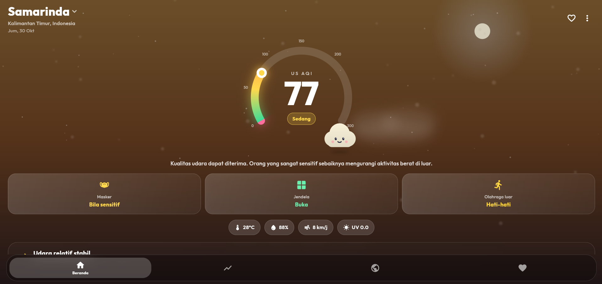

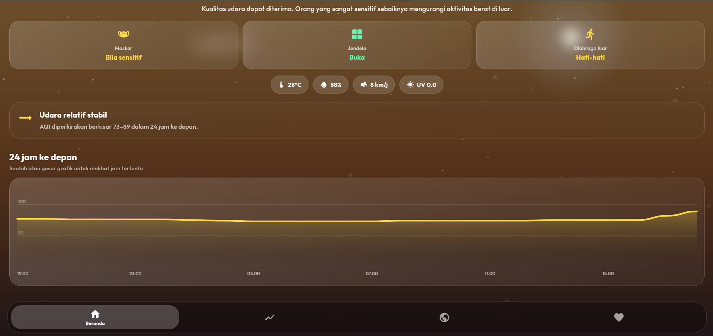

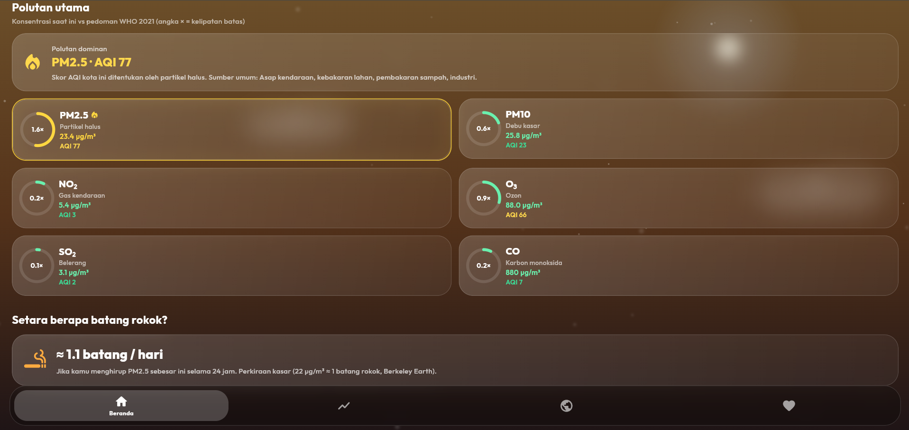

### 🌤️ Prakiraan

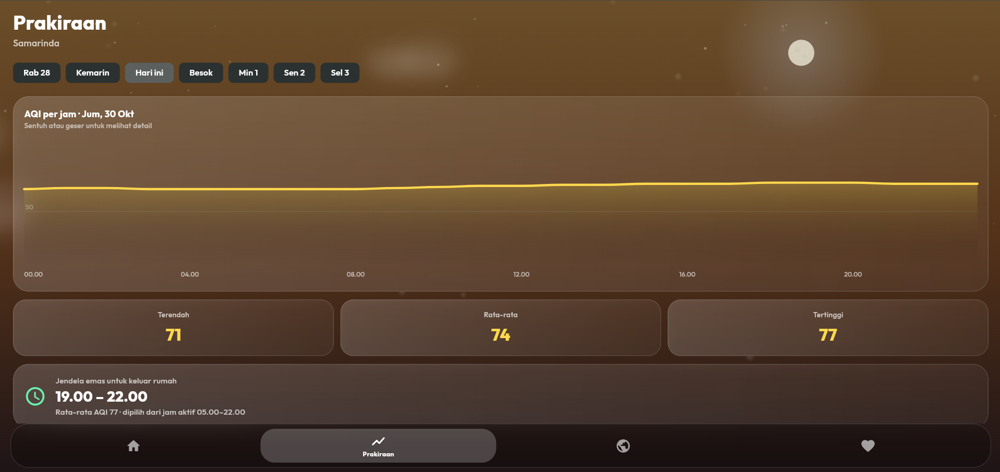

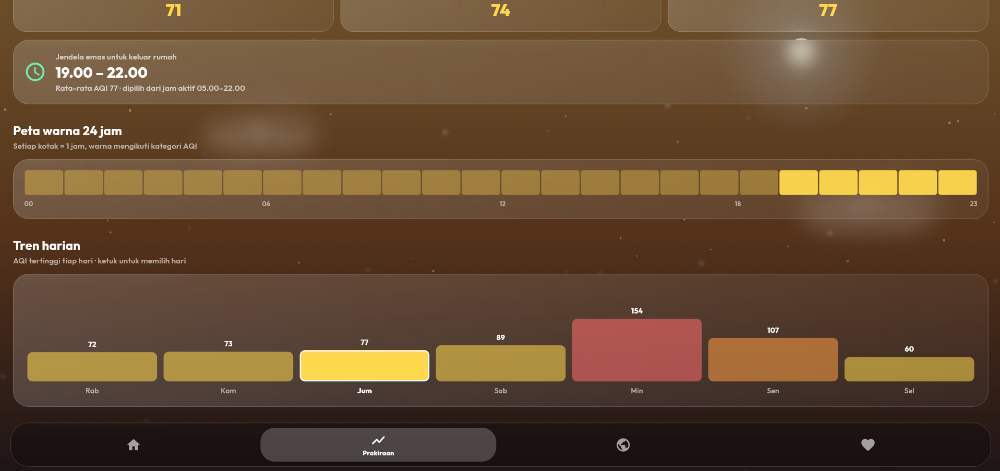

### 🌍 Jelajah Kota

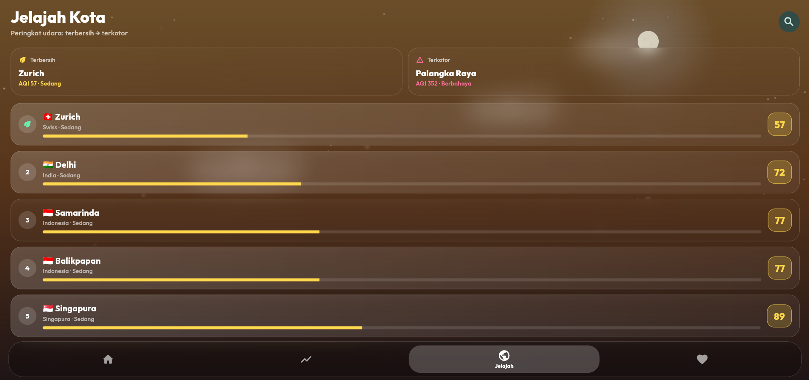

### 💚 Kesehatan

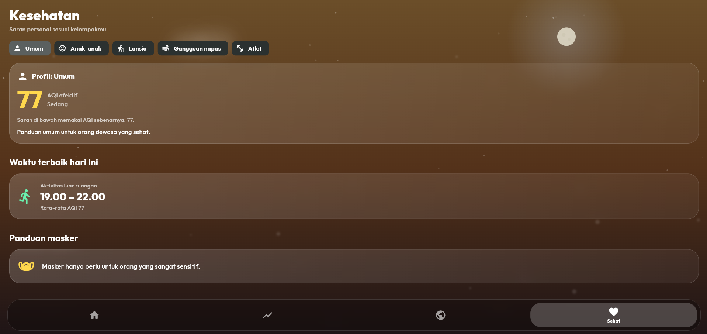

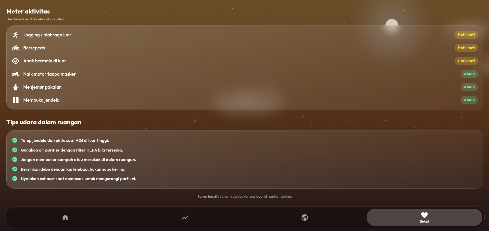

### 🔎 Cari Kota

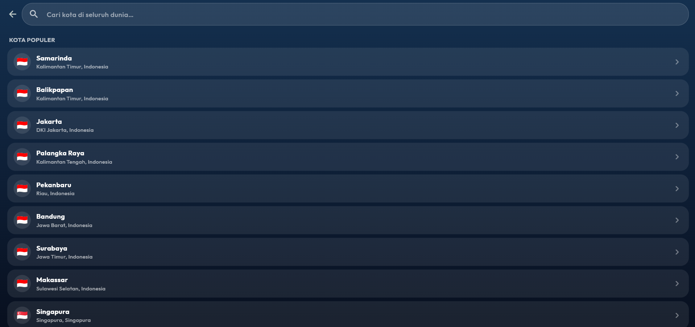

### 📖 Tentang & Edukasi

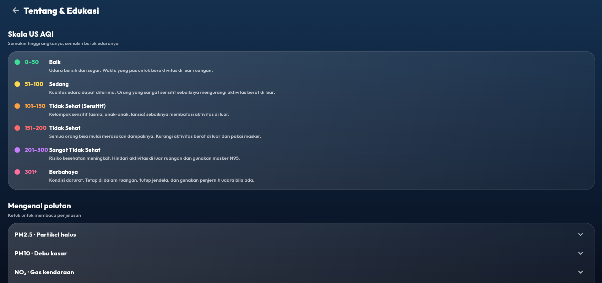

## ✨ Fitur

**Pemantauan**
- **Gauge US AQI** bergradien dengan animasi, cahaya yang "bernapas", dan angka skala.
- **Langit hidup**: warna, awan, partikel, serta matahari/bulan/bintang berubah mengikuti **tingkat polusi** dan **waktu setempat** (siang/malam).
- **Maskot "Awan"**: ekspresinya berubah (tersenyum, berkeringat, memakai masker) sesuai kualitas udara.
- **Polutan dominan**: menunjukkan polutan yang menentukan skor AQI, lengkap dengan AQI per polutan.
- **6 polutan** (PM2.5, PM10, NO₂, O₃, SO₂, CO) dibandingkan dengan pedoman **WHO 2021**.
- Suhu, kelembapan, angin, indeks UV, dan perkiraan **setara batang rokok**.

**Prakiraan & analisis**
- Prakiraan **5 hari ke depan + 2 hari ke belakang**, grafik per jam yang bisa disentuh/digeser.
- **Insight tren**: "udara cenderung memburuk/membaik" beserta jam puncaknya.
- **Jendela emas**: 3 jam terbersih untuk keluar rumah (hanya jam aktif 05.00–22.00 dan hanya jam yang belum lewat).
- **Peta warna 24 jam** dan **tren harian**.

**Personal & praktis**
- **Profil kesehatan** (Umum, Anak-anak, Lansia, Gangguan napas, Atlet) mengubah saran masker dan aktivitas.
- **Peringkat kota** terbersih → terkotor (satu request untuk semua kota), kota favorit, dan riwayat pencarian.
- **Mode offline**: bila internet putus, data terakhir yang tersimpan tetap ditampilkan.
- Pencarian kota seluruh dunia dengan bendera negara, *pull-to-refresh*, dan salin ringkasan.
- Halaman **Tentang & Edukasi**: skala AQI, penjelasan polutan, sumber data, dan catatan akurasi.

## 🔌 API yang Digunakan

Semuanya **gratis dan tanpa API key** ([Open-Meteo](https://open-meteo.com)).

| API | Endpoint | Kegunaan |
|---|---|---|
| Air Quality | `GET https://air-quality-api.open-meteo.com/v1/air-quality` | AQI, polutan, UV, AQI per polutan, prakiraan per jam |
| Forecast | `GET https://api.open-meteo.com/v1/forecast` | Suhu, kelembapan, angin |
| Geocoding | `GET https://geocoding-api.open-meteo.com/v1/search` | Pencarian kota |

Contoh request kualitas udara:

```text
https://air-quality-api.open-meteo.com/v1/air-quality
?latitude=-0.5022&longitude=117.1537
&current=us_aqi,pm10,pm2_5,carbon_monoxide,nitrogen_dioxide,sulphur_dioxide,ozone,uv_index,us_aqi_pm2_5,us_aqi_pm10,us_aqi_nitrogen_dioxide,us_aqi_ozone,us_aqi_sulphur_dioxide,us_aqi_carbon_monoxide
&hourly=us_aqi,pm2_5&past_days=2&forecast_days=5&timezone=auto
```

**Pemetaan data ke tampilan**

| Field JSON | Ditampilkan sebagai |
|---|---|
| `current.us_aqi` | Gauge, kategori, warna langit, ekspresi maskot |
| `current.pm2_5 / pm10 / no2 / o3 / so2 / co` | Kartu polutan + rasio terhadap WHO |
| `current.us_aqi_<polutan>` | AQI per polutan dan polutan dominan |
| `hourly.us_aqi` | Grafik 24 jam, prakiraan, jendela emas, insight tren |
| `current.uv_index` | Chip UV |

> **Atribusi:** data kualitas udara dari model [CAMS (Copernicus Atmosphere Monitoring Service)](https://atmosphere.copernicus.eu) melalui Open-Meteo; geocoding dari GeoNames.

## 🧠 Arsitektur

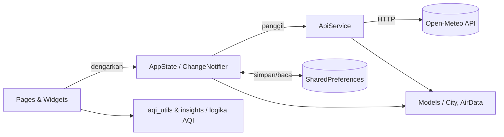

- **State management:** `ChangeNotifier` + `ListenableBuilder` (tanpa package tambahan).
- **Penanganan error:** timeout 15 detik, cadangan request bila variabel API ditolak, cache offline, dan penanda request terbaru agar respons lama tidak menimpa kota yang baru dipilih.
- **Tampilan kustom:** gauge, maskot, grafik, dan langit digambar dengan `CustomPainter`.

## 📊 Skala US AQI

| AQI | Kategori |
|---|---|
| 0–50 | Baik |
| 51–100 | Sedang |
| 101–150 | Tidak Sehat bagi Kelompok Sensitif |
| 151–200 | Tidak Sehat |
| 201–300 | Sangat Tidak Sehat |
| 301+ | Berbahaya |

## 🛠️ Teknologi

Flutter · Dart · [`http`](https://pub.dev/packages/http) · [`shared_preferences`](https://pub.dev/packages/shared_preferences) · [`google_fonts`](https://pub.dev/packages/google_fonts) · `CustomPainter`

## 🚀 Cara Menjalankan

Prasyarat: Flutter SDK 3.19+ dan emulator/HP Android.

```bash
git clone <url-repo-kelompok>
cd udara_kita
bash tool/setup_android.sh
flutter run
```

**Cara manual (tanpa skrip)**

```bash
flutter create --platforms=android .
flutter pub get
```

Lalu tambahkan izin internet di `android/app/src/main/AndroidManifest.xml`, tepat di atas tag `<application>`:

```xml
<uses-permission android:name="android.permission.INTERNET"/>
```

> Font Outfit diunduh otomatis oleh `google_fonts` saat pertama kali dijalankan dengan internet.

## 🧪 Pengujian

```bash
flutter test
```

Mencakup batas kategori AQI, parsing JSON API, polutan dominan, emoji bendera, dan pencarian jendela emas.

## 📁 Struktur Proyek

```text
udara_kita/
├── docs/
│   └── screenshots/
│       ├── home1.png
│       ├── home2.png
│       ├── home3.png
│       ├── forecast1.png
│       ├── forecast2.png
│       ├── explore.png
│       ├── health1.png
│       ├── health2.png
│       ├── search.png
│       └── about.png
├── lib/
│   ├── main.dart
│   ├── home_shell.dart
│   ├── state.dart
│   ├── api.dart
│   ├── models.dart
│   ├── aqi_utils.dart
│   ├── insights.dart
│   ├── ui.dart
│   ├── search_page.dart
│   ├── about_page.dart
│   ├── pages/
│   └── widgets/
├── test/
│   └── widget_test.dart
├── tool/
│   └── setup_android.sh
├── pubspec.yaml
└── README.md
```

## ⚠️ Batasan

- Data berasal dari **model prakiraan**, bukan sensor di lokasi pengguna, sehingga bisa berbeda dari stasiun pemantau lokal.
- Perbandingan dengan pedoman WHO bersifat indikatif (nilai saat ini vs rata-rata 24 jam).
- Saran kesehatan bersifat umum dan **bukan pengganti nasihat dokter**.